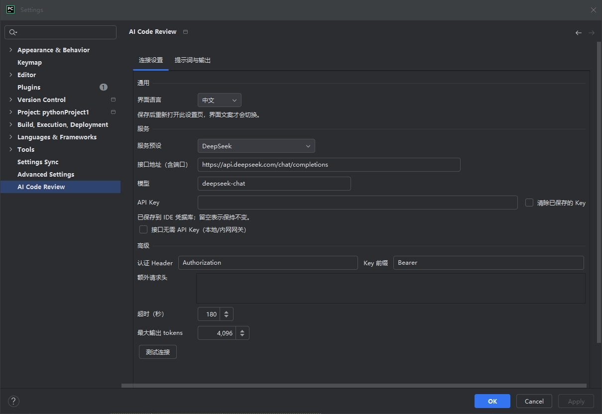
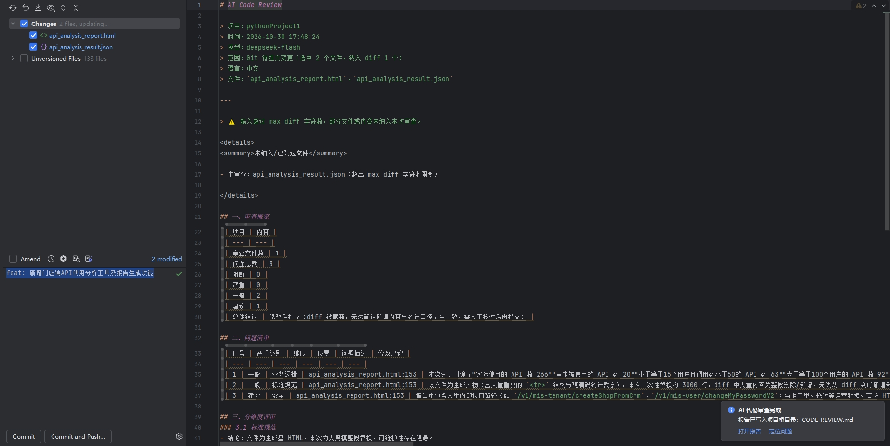
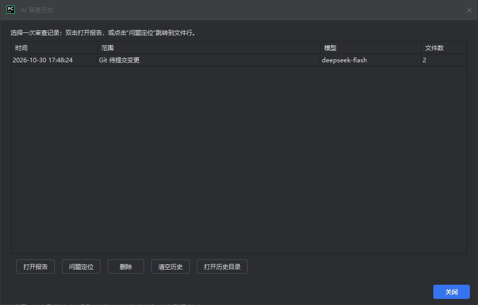
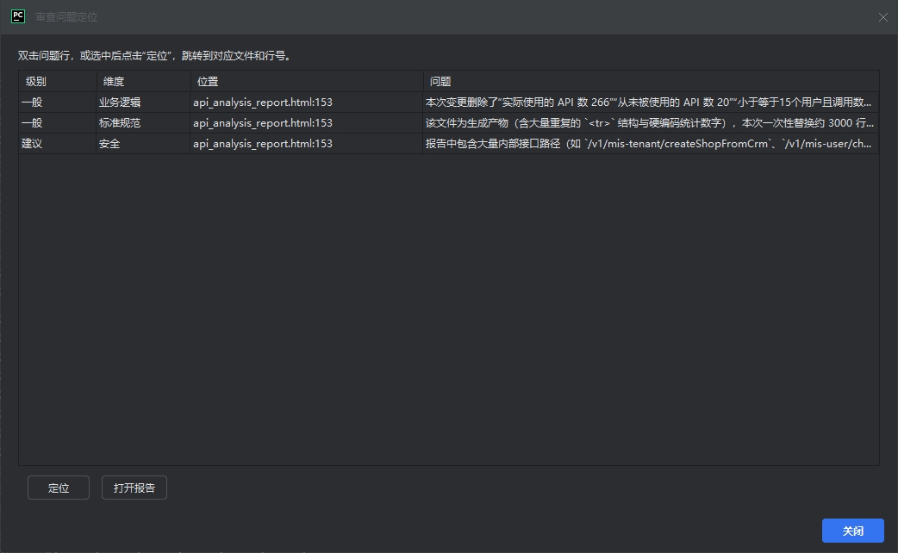

# tonkane AI Code Review（IDEA 插件）


GitHub: https://github.com/tonkane/ai-code-review-idea-plugin

在 IntelliJ IDEA 的 Git 提交区勾选文件，或直接在 Git 历史记录中选中某次提交，点击一次即可让 AI 按固定模板生成 Markdown 审查报告；支持中英文界面/模板、本地历史记录和问题定位。

**English:** Review checked pending changes or a single Git commit with any OpenAI-compatible API. The plugin uses a fixed four-dimension Markdown template (standards, business logic, performance, security), keeps local review history, and turns `file:line` findings into clickable navigation.

## 界面预览 / Screenshots



*连接设置与提示词模板 / Connection settings and prompt template*



*在 Commit 工具窗审查勾选文件 / Review checked files in the Commit tool window*



*本地审查历史 / Local review history*



*问题定位，双击跳转到文件行 / Click a finding to jump to its file and line*

## 功能

- **两种审查范围**：读取 Commit 工具窗口中 **已勾选** 的更改；或在 Git 历史记录区右键某次提交，选择 **“AI 审查此次提交”**。同一文件中尚未暂存的改动也会呈现在待提交 diff 里，请留意。
- **中英文切换**：设置页可选择中文/English；切换后默认提示词模板也会切换到对应语言（自定义模板不会被覆盖），报告头部同步切换。
- **兼容 OpenAI 格式**：DeepSeek、OpenAI、通义千问 DashScope 兼容模式、Moonshot、智谱 GLM、SiliconFlow、Ollama，以及任何 OpenAI 兼容的 `/chat/completions` 网关。
- **连接可配置**：接口地址（可带端口）、模型、API Key、认证 Header、Key 前缀、超时、最大输出 tokens、额外请求头。
- **Key 安全存储**：API Key 保存在 IDEA 凭据库（PasswordSafe），不会写进插件 XML；错误信息会脱敏。
- **固定审查模板**：标准规范、业务逻辑、性能、安全四个维度；章节、表格列名、严重级别固定，降低每次输出结构漂移。
- **提示词可编辑**：设置页可直接修改模板，支持占位符；可一键恢复默认。
- **固定输出文件**：默认 `CODE_REVIEW.md`，位于项目根目录，每次覆盖；历史记录单独保存在本地系统目录。文件名可改。报告已在编辑器中打开时，完成后会自动重新加载，不需要手动刷新。
- **默认中文**：报告语言默认中文；提示词模板中的 `{{LANGUAGE}}` 可替换。
- **本地审查历史**：每次审查额外保存一份报告到本地系统目录，点击底部 **“AI 审查历史”** 可查看、打开、删除或清空。
- **问题定位**：报告生成后可通过通知中的 **“定位问题”**，或历史记录里的 **“问题定位”**，双击 `文件:行号` 直接跳转到源码位置。
- **后台执行**：可取消、不阻塞编辑；完成后通知并可直接打开报告。

## 环境要求

- IntelliJ IDEA 2024.1 或更高版本（`since-build=241`）。
- 构建使用 JDK 17。

## 构建与安装

在项目目录执行：

```bash
./gradlew buildPlugin
```

Windows 也可以：

```powershell
.\gradlew.bat buildPlugin
```

如果从 zip 解压后 `gradlew` 没有执行权限，先执行 `chmod +x gradlew`。

构建产物位于：

```text
build/distributions/ai-git-code-review-1.1.8.zip
```

安装：

1. IDEA → `Settings` → `Plugins` → 齿轮 → `Install Plugin from Disk...`
2. 选择上面的 zip。
3. 重启 IDEA。

也可以直接运行 `./gradlew runIde` 启动一个带插件的测试 IDE。

> 项目已包含 Gradle Wrapper。如果机器上无法下载 Gradle，可用本机 Gradle 8.5+ 执行同样的任务。

## 使用

### 审查待提交更改

1. 打开 IDEA 底部的 **Commit** 工具窗口。
2. 在待提交文件列表中 **勾选** 要审查的文件（这一步就是选择审查范围）。
3. 点击提交工具栏上的 **“AI 审查勾选的更改”**（放大镜/代码图标）。如果工具栏空间不足，它会收进 `>>`/`...` 更多操作里；也可在文件右键菜单 → Git 子菜单中使用。
   - 也可以从 `Tools` 菜单执行；没有勾选时会弹出文件选择框。
   - 在 Commit 工具窗口没有勾选任何文件时，会提示先勾选，避免误审查整个项目。
4. 首次使用先在 `Settings` 的搜索框输入 `AI Code Review`，打开配置页填写接口和 Key。
5. 审查完成后，项目根目录的 `CODE_REVIEW.md` 会被覆盖写入，并弹出通知；默认自动打开报告。

### 审查某次 Git 提交

1. 打开 **Git** 工具窗口的 **Log** 标签页。
2. 在提交列表中选择一条提交，右键 → **“AI 审查此次提交”**。
3. 报告同样写入 `CODE_REVIEW.md`，并在本地历史中保留一份。

### 语言切换

- 设置页顶部 **界面语言** 选择 `中文`/`English`，点击 `Apply`。
- 默认提示词模板会立即切换；设置页自身文案需要重新打开设置页后生效。
- 如果你已自定义提示词，切换语言不会覆盖它；可点击“恢复默认提示词”使用当前语言模板。

### 历史记录与问题定位

- 底部提交操作区的 **“AI 审查历史”** 按钮可查看本轮项目所有本地审查记录（审查按钮也在底部，顶部不再重复显示）。
- 历史记录中双击打开报告；点击 **“问题定位”** 可查看 `文件:行号` 列表，双击即可跳转。
- 打开 `CODE_REVIEW.md` 后，在编辑器内右键 → **“AI 审查问题定位”** 也可以打开同一列表。
- 历史文件保存在 IDEA 系统目录下的 `ai-git-code-review/history/<项目哈希>/`，不会写入 Git 仓库。
- 生成完成通知中也有 **“定位问题”** 按钮。

### 配置项说明

| 配置 | 说明 |
| --- | --- |
| 界面语言 | 中文/English；默认提示词随语言切换，设置页文案需重开生效 |
| 服务预设 | 选择后自动填入接口地址和常用模型名，不会清空 API Key |
| 接口地址（含端口） | 完整 URL，例如 `https://api.deepseek.com/chat/completions`；也可以只填 `https://api.deepseek.com`，程序会补全路径 |
| 模型 | 例如 `deepseek-chat`、`gpt-4o-mini`、`qwen-plus` |
| API Key | 保存在 IDE 凭据库；留空表示保持已保存的 Key 不变；可勾选清除 |
| 接口无需 API Key | 本地 Ollama 或内网无鉴权网关勾选；勾选后请求不发送认证 Header |
| 测试连接 | 在设置窗口内直接显示成功/失败；最长等待 30 秒，超时会给出错误提示 |
| 认证 Header / Key 前缀 | 默认 `Authorization` + `Bearer `；某些网关可能需要 `api-key` 等 |
| 额外请求头 | 每行一个 `Header: Value`，例如网关的租户头；不要填 `Content-Length`/`Host` |
| 超时 | 单次 HTTP 请求超时，默认 180 秒 |
| 最大输出 tokens | 默认 4096；报告被截断时可调大 |
| 输出文件 | 只能是项目根目录下的文件名，默认 `CODE_REVIEW.md` |
| 报告语言 | 默认中文，替换提示词里的 `{{LANGUAGE}}` |
| 温度 | 默认 0.1，越低越稳定 |
| 最大 diff 字符数 | 默认 60000；超出会截断并在报告中标注 |
| 自动打开报告 | 完成后自动在编辑器中打开 Markdown |
| 提示词模板 | 内置模板可直接修改；支持 `{{PROJECT_NAME}}`、`{{FILE_LIST}}`、`{{LANGUAGE}}`、`{{DATE}}`、`{{DIFF}}` |

### 接口地址补全规则

- 以 `/chat/completions` 结尾：原样使用。
- 以 `/v1`（或 `/v2` 等版本段）结尾：追加 `/chat/completions`。
- 只填域名/根路径：追加 `/v1/chat/completions`。
- 带 `?` 查询参数的 URL：视为完整地址，原样使用（适合 Azure 等特殊网关）。

例如：

```text
https://api.deepseek.com
→ https://api.deepseek.com/v1/chat/completions

http://localhost:11434
→ http://localhost:11434/v1/chat/completions
```

## 报告结构

报告由 `ReviewReport` 加固定头部，正文严格按提示词模板输出：

```markdown
# AI Code Review

> 项目：demo
> 时间：2026-10-28 11:00:00
> 模型：deepseek-chat
> 范围：Git 待提交变更（3 个文件）
> 语言：中文
> 文件：`src/A.java`、`src/B.java`、`src/C.java`

---

## 一、审查概览
| 项目 | 内容 |
| --- | --- |
| 审查文件数 | 3 |
| 问题总数 | 2 |
| 阻断 | 0 |
| 严重 | 1 |
| 一般 | 1 |
| 建议 | 0 |
| 总体结论 | 修改后提交 |

## 二、问题清单
| 序号 | 严重级别 | 维度 | 位置 | 问题描述 | 修改建议 |
| --- | --- | --- | --- | --- | --- |
| 1 | 严重 | 安全 | src/A.java:42 | ... | ... |

## 三、分维度评审
### 3.1 标准规范
...
### 3.2 业务逻辑
...
### 3.3 性能
...
### 3.4 安全
...

## 四、提交建议
...

## 五、审查说明
...
```

## 实现说明

- **范围读取**：优先通过 `VcsDataKeys.COMMIT_WORKFLOW_UI` 拿到 `getIncludedChanges()` / `getIncludedUnversionedFiles()`，即提交区中实际勾选的条目；不在提交区时回退到 `SELECTED_CHANGES`，再回退到文件选择框。
- **快照**：在后台读操作中读取变更前后的文本，跳过二进制、单文件约 1 MB、总文本 1200 万字符或读取失败的内容，并记录在报告头部。
- **diff**：内置行级 LCS，生成标准 unified diff；超大文件退化为确定性的整段替换，避免卡死。
- **模板**：内置提示词把四个维度、严重级别和输出章节写死；`temperature` 默认 0.1，降低格式漂移。
- **网络**：Java 17 `HttpClient`，非流式 `/chat/completions`，兼容 `choices[0].message.content`、`choices[0].text` 和数组形式 content。
- **输出**：先写临时文件再原子替换，避免中途失败留下半份报告。

## 常见问题

**401 / 403**
检查 API Key、认证 Header 和前缀。DeepSeek/OpenAI 通常是 `Authorization` + `Bearer `。

**404**
检查接口地址是否包含正确的 `/v1`、`/chat/completions` 路径，以及模型名是否存在。

**429**
请求频率或额度限制；稍后重试或更换 Key/模型。

**超时 / SSL**
检查网络、代理、公司网关证书。程序使用 JVM 默认代理设置；必要时给 IDEA 配置 `-Dhttps.proxyHost` 等参数。

**报告被截断**
调大“最大输出 tokens”；如果输入 diff 过长，调大“最大 diff 字符数”，或减少勾选文件。

**提示“请先在提交区勾选文件”**
当前处于非模态 Commit 工具窗口上下文但勾选为空。先在提交区勾选，或从 `Tools` 菜单使用文件选择框。

## 已知限制

- 只支持 OpenAI 兼容的 `/chat/completions` 非流式接口；Anthropic 原生 Messages API、Gemini 原生 API 需要网关转换。
- 只审查文本 diff；二进制、超大文件、纯重命名（无内容变化）会跳过。
- 删除行的行号来自旧文件，提示词要求模型注明“删除行”。
- Git Log 提交审查一次只支持选中一条提交；问题定位依赖模型按 `文件:行号` 输出。
- 设置页界面语言切换后，需要重新打开设置页才能更新设置页自身文案；提示词会立即切换。
- AI 结论需要人工复核；插件不会执行代码、测试或依赖漏洞扫描。
- diff 会发送到你配置的第三方服务，请确认代码脱敏与合规要求。

## 项目结构

```text
src/main/java/com/aicodereview/
├── action/        提交区入口、Git Log 提交审查、文件选择框
├── config/        设置状态、预设、凭据存储、设置页、中英文文案
├── core/          变更快照、unified diff、提示词、报告、后台任务
├── history/       本地审查历史存储、历史列表、历史入口
├── llm/           OpenAI 兼容客户端
├── review/        问题表格解析、问题定位弹窗
└── output/        报告文件写入与打开
src/main/resources/
├── META-INF/plugin.xml
└── icons/
```
